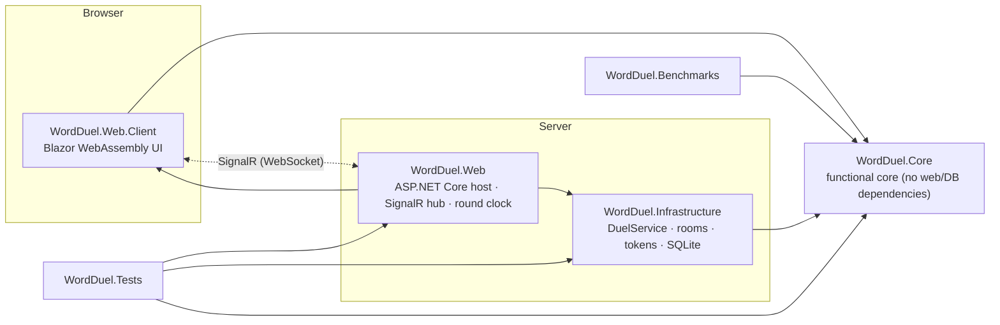
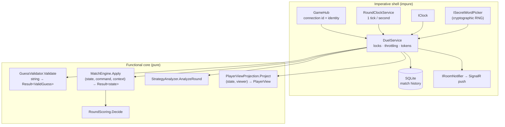
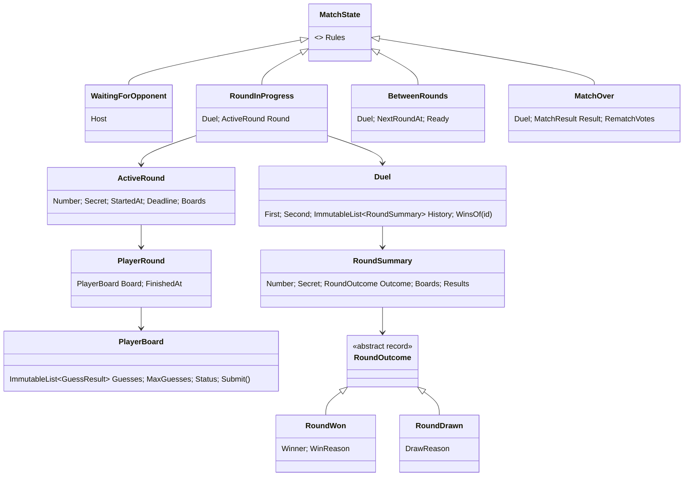
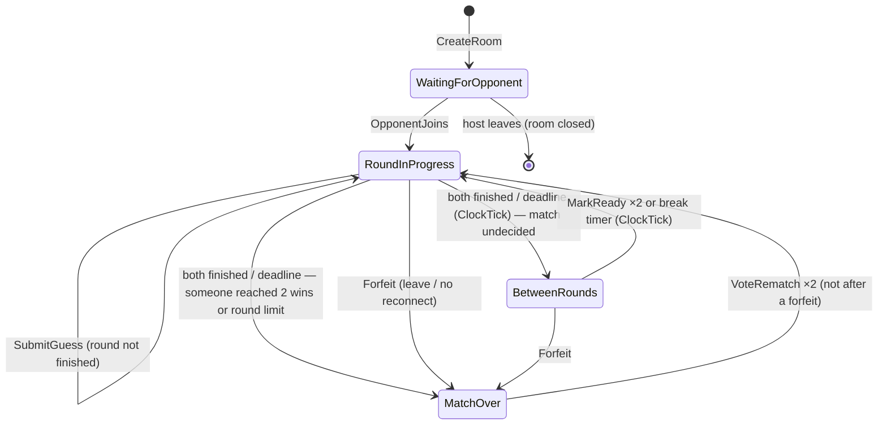
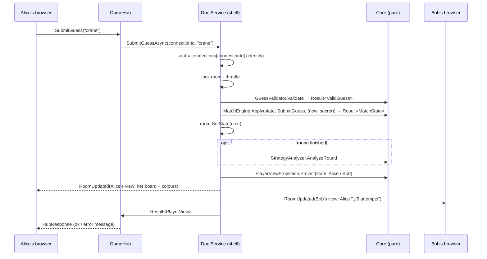

# Architecture

Word Duel follows the **functional core / imperative shell** pattern introduced in Lecture 1
("a functional core performs calculations while an imperative shell handles the outside world")
and applied to a turn-based game in Lecture 10 (Martian Trail).

* **Functional core** — `WordDuel.Core`: immutable records, pure functions, discriminated unions.
  It knows nothing about HTTP, SignalR, Blazor, databases, clocks or random numbers.
* **Imperative shell** — `WordDuel.Infrastructure` + `WordDuel.Web` (+ the browser UI): network,
  identity, time, randomness, locking, persistence, logging. It calls the core and stores its results.

## 1. Projects and dependencies

`WordDuel.Core` is referenced by **both** the server and the WebAssembly client. The server uses it as the
authoritative rule engine; the browser uses it for rendering helpers (keyboard colours) and for the
single-player practice mode — the same pure functions run in two very different hosts.

| Project | Responsibility | Key files |
|---|---|---|
| `WordDuel.Core` | rules, state transitions, scoring, analyzer, read models, wire contracts | `Words/WordleEvaluator.cs`, `Match/MatchEngine.cs`, `Analysis/StrategyAnalyzer.cs`, `Views/PlayerViewProjection.cs` |
| `WordDuel.Infrastructure` | orchestration, rooms, seats, tokens, clock, secrets, persistence | `DuelService.cs`, `Rooms/GameRoom.cs`, `Rooms/RoomRegistry.cs`, `Persistence/MatchHistory.cs` |
| `WordDuel.Web` | composition root, SignalR hub, background clock, HTTP endpoints | `Program.cs`, `Hubs/GameHub.cs`, `ServiceRegistration.cs` |
| `WordDuel.Web.Client` | pages, reusable components, client state container | `Pages/Room.razor`, `Components/*.razor`, `Services/DuelConnection.cs` |

## 2. Functional core vs imperative shell

The only mutable game data is one field: `GameRoom.State`. It is replaced (never modified) by
`GameRoom.SetState(next)` with the value returned by `MatchEngine.Apply`, while the room's
`SemaphoreSlim` is held. Everything inside `MatchState` is immutable (`record`, `ImmutableList`,
`ImmutableDictionary`, `ImmutableHashSet`).

Impure inputs reach the core as **explicit arguments**:

* current time and the next secret → `TransitionContext(Now, NextSecret)`
* the dictionary → `WordDictionary` parameter
* presence / analyses / room code → `ProjectionContext`

## 3. Domain model

Design choices:

* **Each state carries only meaningful data** (Lecture 5 "merged-object problem"): a waiting room has no
  score, a finished match has no deadline. Impossible combinations cannot be constructed.
* **Closed unions**: the base records have `private protected` constructors, so no other assembly can add a case.
* **The score is derived** from `Duel.History` with LINQ (`WinsOf`), never stored separately → no drift.
* **`ValidGuess` is a smart type** with an internal constructor: a `SubmitGuess` command cannot even be built
  from an unvalidated string (Lecture 10, `ValidSpend`).

## 4. State transitions

`MatchEngine.Apply` is a single switch over the `(state, command)` tuple. Every unlisted combination returns
a `Failure` (e.g. `RoundNotActive`, `RoomFull`, `InvalidAction`) instead of throwing.

### Rules encoded in the engine

| Rule | Where |
|---|---|
| Wordle feedback incl. duplicates | `WordleEvaluator.Evaluate` (greens first, then yellows consume remaining copies) |
| 6 guesses, no repeated word, no guess after finishing | `PlayerBoard.Submit` |
| Round ends when both boards finish or at the deadline | `MatchEngine.ApplyGuess`, `ClockTick` arm |
| Only solver wins; fewer guesses; faster server time; else draw | `RoundScoring.Decide` |
| First to 2 wins; draws score nothing; hard cap of 5 rounds | `MatchEngine.DecideMatch` |
| Next round: both ready or 45 s break | `ApplyReady`, `ClockTick` arm |
| Rematch needs both votes, not after a forfeit | `ApplyRematchVote` |

**Timing.** The round starts at the server time of the transition that created it (`StartedAt`).
A player's completion time is the server time at which the guess that finished their board was processed
(`FinishedAt`). Solve time = `FinishedAt − StartedAt`. Client clocks are never used.

## 5. SignalR communication

Hub: `/hubs/duel` (`WordDuel.Web/Hubs/GameHub.cs`), strongly typed with `IGameClient`.

| Client → server | Returns | Notes |
|---|---|---|
| `CreateRoom(nickname)` | `HubResponse<SessionTicket>` | ticket = room code, player id, **token**, first view |
| `JoinRoom(code, nickname)` | `HubResponse<SessionTicket>` | fails with `RoomNotFound`, `RoomFull`, `InvalidRoomCode` |
| `Resume(code, token)` | `HubResponse<SessionTicket>` | re-binds a seat after refresh/reconnect |
| `SubmitGuess(word)` | `HubResponse<PlayerView>` | identity taken from `Context.ConnectionId` |
| `Ready()`, `Rematch()` | `HubResponse<PlayerView>` | |
| `Leave()` | `HubResponse<bool>` | forfeits a running match |

| Server → client | Payload |
|---|---|
| `RoomUpdated(view)` | a complete, **personalised** `PlayerView` snapshot |

**Snapshots instead of events.** Every change pushes a full view per player. A client never has to
reconstruct state from a sequence of events, so a missed message or a reconnect is fixed by the next
snapshot (or by `Resume`, which returns one). Views older than the current one are ignored
(`DuelConnection.Apply` compares `ServerTime`).

### Guess submission sequence

## 6. Security model

| Threat | Defence |
|---|---|
| Reading the answer in the browser | the secret exists only in `ActiveRound` on the server; `PlayerViewProjection` never copies it until the round is a `RoundSummary`; tests serialise views and assert the secret is absent |
| Seeing the opponent's guesses | the projection reads only `AttemptsUsed` and `IsFinished` of the opponent's board during a round |
| Guessing for another player | the hub never accepts a player id; the seat is looked up from `Context.ConnectionId` |
| Taking over a seat with the room code | resuming needs the 256-bit random token, compared with `CryptographicOperations.FixedTimeEquals` |
| Faking scores, times or feedback | clients send only raw strings; all feedback, times and results are computed on the server |
| Spamming / duplicate submissions | 200 ms throttle per player, per-room lock, repeated words rejected without using an attempt |
| Predicting secrets | `RandomNumberGenerator.GetInt32` (cryptographic RNG); secrets of the current match are not repeated |
| Resource exhaustion | `MaxRooms`, idle-room cleanup, 16 KB SignalR message limit |
| Leaking internals | errors are `GameError` values with user-safe messages; exceptions are logged server-side only |
| Public endpoints | `/health` (room count) and `/api/history` (finished matches: nicknames and scores only) |

## 7. Disconnects and reconnection

1. The browser keeps `{roomCode, playerId, token}` in **sessionStorage** (per tab).
2. SignalR's automatic reconnect retries (0, 1, 2, 5, 10, 20, 30 s). On success the client calls `Resume`.
3. A page refresh calls `Resume` from `Room.razor` on load.
4. The server marks a dropped seat `Disconnected`; the opponent sees a banner. After
   `ReconnectGraceSeconds` (60 s) the background clock converts it into a `Forfeit` command.
5. A room whose seats have all left, or that has been idle for 30 minutes, is removed.

## 8. Client state management

* `DuelConnection` (singleton per tab) is a **state container**: it owns the hub connection, keeps the latest
  `PlayerView`, and raises `Changed`. Components subscribe in `OnInitialized` and unsubscribe in `Dispose`.
* `UserPreferences` is provided to the whole tree as a **cascading value** from `MainLayout`.
* `ToastService` is a tiny immutable-list state container rendered by `ToastHost`.
* Components such as `WordTile`, `GuessRow`, `WordBoard`, `VirtualKeyboard` are purely presentational: all
  data in through `[Parameter]`s, all actions out through `EventCallback`s. `DataTable<TItem>` and `Modal`
  are templated components (`RenderFragment`, `RenderFragment<TItem>`).

## 9. Persistence

`DuelService` saves a `FinishedMatch` (nicknames, scores, winner, end reason) when a match ends.
`SqliteMatchHistory` uses `IDbContextFactory<MatchHistoryDbContext>` (a short-lived context per call, thread-safe).
The database is created with `EnsureCreated` on startup; failures are logged and never affect a live match.
The leaderboard is computed in memory by the pure `Leaderboard.Compute` (LINQ `SelectMany`/`GroupBy`).

## 10. Important design decisions

| Decision | Alternatives considered | Why |
|---|---|---|
| Blazor WebAssembly + explicit SignalR hub | Blazor Server (implicit SignalR circuit) | explicit, testable real-time boundary; UI state lives in the browser, the server holds only game state (better scalability) |
| Own `Maybe`/`Result` (≈60 lines) | LanguageExt, OneOf, CSharpFunctionalExtensions (Lecture 9/10) | identical to the lecture style; no third-party types in public APIs; easy to explain in the defense |
| `Result.Bind` does not catch exceptions | Lecture 6 Bind catches into `Error` | domain failures are values; exceptions mean bugs and should stay loud; `ResultExtensions.Try` is used at boundaries |
| `TransitionContext` parameter | Reader monad (Lecture 6) | same idea (environment supplied at run time) with plain C# — simpler to read |
| Full snapshot per update | event deltas | trivially consistent after reconnects; payloads are small (a few KB) |
| In-memory rooms | database or Redis | a match lasts minutes; persistence only for finished matches |
| `FrozenSet` for the dictionary | `HashSet`, `ImmutableHashSet` | immutable and the fastest read-only set in .NET 8+ |

## 11. Scalability notes

* One server comfortably holds thousands of rooms: a room is a few KB, a guess is processed in microseconds,
  round analysis takes ~1.7 ms (see `docs/PERFORMANCE.md`).
* Rooms are independent: the per-room lock means rooms never block each other.
* To scale out horizontally, `RoomRegistry` would move to a shared store (e.g. Redis) and SignalR would use a
  backplane (Redis or Azure SignalR Service). Because the game logic is pure and the state is an immutable value,
  it serialises naturally — the core would not change.
